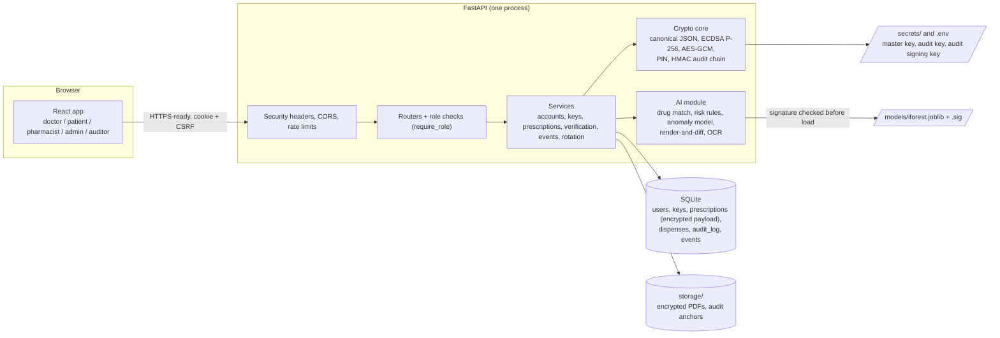
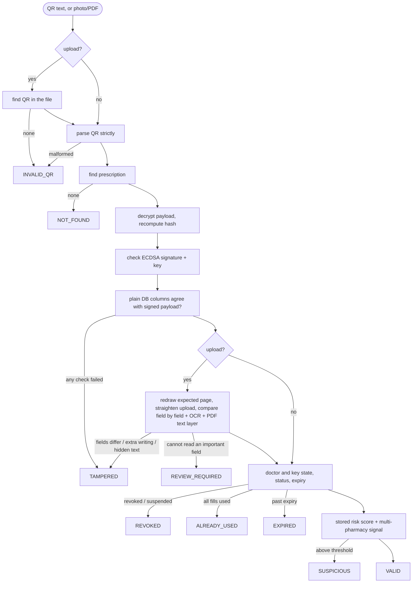

# Architecture

Pramaan is one FastAPI process plus a React app that it serves. State lives in SQLite and an encrypted `storage/` folder. Nothing else is needed to run it.

## Components



## Issuing

```mermaid
sequenceDiagram
  participant D as Doctor (browser)
  participant A as API
  participant K as Key store
  participant P as PDF + QR
  D->>A: medicines, patient, signing password
  A->>A: build payload v2, reject anything that cannot be printed faithfully
  A->>A: risk check (rules + anomaly model); override reason if high
  A->>K: unlock doctor's private key (password, lockout rules)
  A->>A: canonical JSON -> SHA-256 -> ECDSA signature
  A->>P: render PDF from the SAME payload; QR = id.key.hash.signature
  A->>A: encrypt payload + PDF under a fresh data key, wrap it with the master key
  A->>A: store everything and the audit entry in one transaction
  A-->>D: signed prescription (PDF download)
```

## Verification decision flow



Precedence when several apply: TAMPERED > REVOKED > ALREADY_USED > EXPIRED > SUSPICIOUS > REVIEW_REQUIRED > VALID. Verification never consumes a fill; only dispensing does, with the patient's PIN, in one atomic update.

## Where the security properties come from

| Property | Mechanism | Code |
|---|---|---|
| What you see is what was signed | The PDF is rendered from the signed payload; uploads are compared field by field with a redrawn copy | `core/payload.py`, `core/pdf.py`, `ai/content_check.py` |
| Authenticity | ECDSA P-256 per doctor, domain-separated, fixed-length signatures | `core/crypto.py`, `core/keys.py` |
| Confidentiality at rest | Per-prescription AES-256-GCM data key, wrapped by the master key | `core/crypto.py`, `services/rotation.py` |
| No double spend | One conditional UPDATE plus `UNIQUE(rx_id, fill_no)` | `services/verification_service.py` |
| Consent | Patient PIN derived from a per-prescription secret, 3-try lock | `core/pin.py` |
| Accountability | HMAC-chained audit log, signed checkpoints, external anchor file | `core/audit.py` |
| Model integrity | Model file signed; signature verified before it is unpickled | `ai/model_io.py` |
