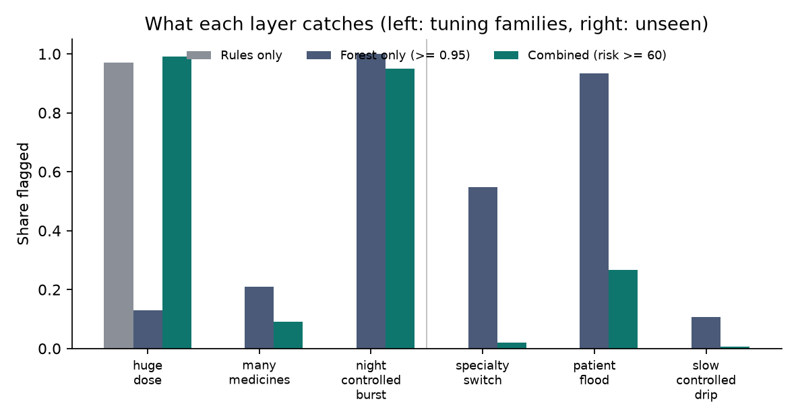
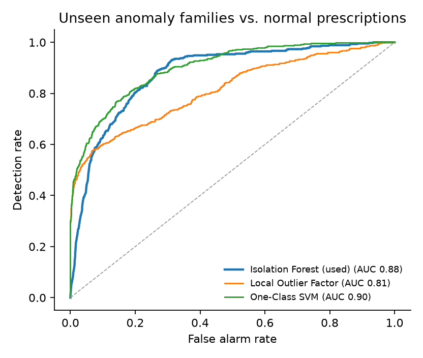
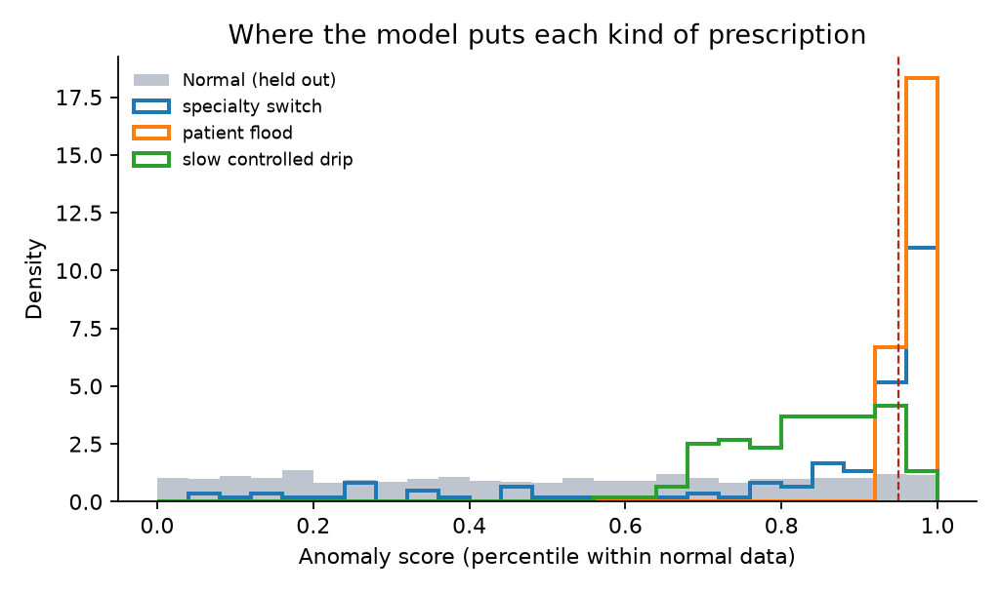

# Evaluation

<!-- upload-eval:start -->
## Upload verification (Phase 7)

Generated by `scripts/evaluate_upload.py` on 2026-10-19. 58 files from 3 different prescriptions.

> **Read this first.** The photographs here are *simulated* (perspective, rotation, blur, sensor noise, uneven light, JPEG compression), not real phone captures. They are a controlled stress test. Real photos have shadows, folds and glare that this set does not contain, and the verdict for those is correspondingly more often `REVIEW_REQUIRED`.

### Confusion matrix

Rows are what the file really is; columns are what Pramaan said. The last column is the share said VALID / the share said TAMPERED.

| Actual | Files | VALID | REVIEW_REQUIRED | TAMPERED | VALID % / TAMPERED % |
|---|---|---|---|---|---|
| Genuine, digital (original PDF, PNG, JPEG) | 9 | 9 | 0 | 0 | 100% / 0% |
| Genuine, simulated photo | 12 | 12 | 0 | 0 | 100% / 0% |
| Tampered, digital | 29 | 0 | 0 | 29 | 0% / 100% |
| Tampered, simulated photo | 8 | 0 | 0 | 8 | 0% / 100% |

### Acceptance criteria

- Genuine digital files give VALID: **9/9** (required 100%).
- Genuine photos are never TAMPERED: **0** of 12 were (required: none; VALID or REVIEW_REQUIRED in at least 95%, here 100%).
- Tampered digital files give TAMPERED: **29/29** (required at least 95%).
- The tampered field was outlined in **28/28** digital cases that name one field.
- Tampered simulated photos give TAMPERED: **8/8**, REVIEW_REQUIRED 0, VALID 0.
- Time per file (this laptop, CPU only): median **3.9 s**, slowest 6.7 s.

### Extra stress run on genuine photos

`scripts/stress_photos.py` takes the same three prescriptions and simulates 75 more phone photos of the *unaltered* page, a third of them deliberately bad (heavy blur, strong noise, JPEG quality 40-60). Last measured result: **75 of 75 VALID, none TAMPERED, none REVIEW_REQUIRED**. A first run of this check found a real bug (OCR lines on one row were read in the wrong order and a genuine page was called TAMPERED); it is fixed and has a regression test.

### How a verdict is reached

1. The QR code is read from the file and its signature is verified first. Only if that succeeds does the page itself get compared.
2. The page that *should* exist is redrawn from the signed content and the upload is straightened onto it using the QR code and three corner marks.
3. Each field is compared with the redrawn field. A field that looks different is read with OCR; the verdict is TAMPERED only when OCR confirms the text differs (or the difference is overwhelming). Blank areas must stay blank.
4. For PDFs the hidden text layer must also match the signed text.
5. If alignment is poor, or a critical field cannot be read, the result is `REVIEW_REQUIRED`: a prompt for the pharmacist to check by eye, never an accusation.

### Every file

| Case | Group | What was done | Verdict | Field outlined | Seconds |
|---|---|---|---|---|---|
| A-orig | genuine-digital | original PDF | VALID | - | 1.2 |
| A-png | genuine-digital | page as PNG | VALID | - | 1.3 |
| A-jpg | genuine-digital | page as JPEG q85 | VALID | - | 1.3 |
| A-photo0 | genuine-photo | simulated photo (seed 1) | VALID | - | 2.7 |
| A-photo1 | genuine-photo | simulated photo (seed 2) | VALID | - | 3.0 |
| A-photo2 | genuine-photo | simulated photo (seed 3) | VALID | - | 2.9 |
| A-photo3 | genuine-photo | simulated photo (seed 4) | VALID | - | 2.8 |
| A-dose | tampered-digital | dose 500 -> 800 mg (one digit) | TAMPERED | med_0_dose | 6.7 |
| A-days | tampered-digital | duration 5 -> 25 days | TAMPERED | med_0_days | 3.4 |
| A-freq | tampered-digital | frequency TDS -> QID | TAMPERED | med_0_freq | 3.9 |
| A-patient | tampered-digital | patient name changed | TAMPERED | patient | 4.0 |
| A-expiry | tampered-digital | expiry extended by a year | TAMPERED | dates | 4.1 |
| A-extra | tampered-digital | extra controlled medicine row added | TAMPERED | med_3_name, med_3_dose, med_3_freq, med_3_days | 4.9 |
| A-overlay | tampered-digital | PDF: white box + new dose drawn over the field | TAMPERED | med_0_dose | 3.2 |
| A-hidden | tampered-digital | PDF: looks identical, text layer says a different dose | TAMPERED | med_0_dose | 4.2 |
| A-licence | tampered-digital | doctor licence number changed | TAMPERED | doctor | 3.3 |
| A-clinic | tampered-digital | clinic renamed | TAMPERED | clinic | 4.5 |
| A-notes | tampered-digital | notes rewritten | TAMPERED | notes | 3.6 |
| A-margin | tampered-digital | extra line scribbled in the blank area | TAMPERED | blank_mid | 5.0 |
| A-name | tampered-digital | medicine name one letter changed | TAMPERED | med_2_name | 3.9 |
| A-photo-dose | tampered-photo | photo of a page with dose 500 -> 800 mg | TAMPERED | med_0_dose | 4.1 |
| A-photo-extra | tampered-photo | photo of a page with an extra medicine row | TAMPERED | med_3_name, med_3_dose, med_3_freq, med_3_days | 5.5 |
| A-photo-patient | tampered-photo | photo of a page with another patient's name | TAMPERED | patient | 6.7 |
| B-orig | genuine-digital | original PDF | VALID | - | 1.6 |
| B-png | genuine-digital | page as PNG | VALID | - | 1.3 |
| B-jpg | genuine-digital | page as JPEG q85 | VALID | - | 1.3 |
| B-photo0 | genuine-photo | simulated photo (seed 5) | VALID | - | 6.6 |
| B-photo1 | genuine-photo | simulated photo (seed 6) | VALID | - | 6.5 |
| B-photo2 | genuine-photo | simulated photo (seed 7) | VALID | - | 2.0 |
| B-dose | tampered-digital | dose 850 -> 150 mg (one digit) | TAMPERED | med_0_dose | 4.4 |
| B-days | tampered-digital | duration 30 -> 50 days | TAMPERED | med_0_days | 4.0 |
| B-freq | tampered-digital | frequency BD -> QID | TAMPERED | med_0_freq | 4.0 |
| B-patient | tampered-digital | patient name changed | TAMPERED | patient | 4.3 |
| B-expiry | tampered-digital | expiry extended by a year | TAMPERED | dates | 3.9 |
| B-extra | tampered-digital | extra controlled medicine row added | TAMPERED | med_1_name, med_1_dose, med_1_freq, med_1_days | 4.3 |
| B-overlay | tampered-digital | PDF: white box + new dose drawn over the field | TAMPERED | med_0_dose | 4.1 |
| B-hidden | tampered-digital | PDF: looks identical, text layer says a different dose | TAMPERED | med_0_dose | 4.3 |
| B-photo-dose | tampered-photo | photo of a page with dose 850 -> 150 mg | TAMPERED | med_0_dose | 5.1 |
| B-photo-extra | tampered-photo | photo of a page with an extra medicine row | TAMPERED | med_1_name, med_1_dose, med_1_freq, med_1_days | 5.2 |
| C-orig | genuine-digital | original PDF | VALID | - | 1.5 |
| C-png | genuine-digital | page as PNG | VALID | - | 1.3 |
| C-jpg | genuine-digital | page as JPEG q85 | VALID | - | 1.5 |
| C-photo0 | genuine-photo | simulated photo (seed 8) | VALID | - | 2.5 |
| C-photo1 | genuine-photo | simulated photo (seed 9) | VALID | - | 1.8 |
| C-photo2 | genuine-photo | simulated photo (seed 10) | VALID | - | 3.2 |
| C-photo3 | genuine-photo | simulated photo (seed 11) | VALID | - | 3.1 |
| C-photo4 | genuine-photo | simulated photo (seed 12) | VALID | - | 3.6 |
| C-dose | tampered-digital | dose 250 -> 550 mg (one digit) | TAMPERED | med_0_dose | 3.9 |
| C-days | tampered-digital | duration 5 -> 25 days | TAMPERED | med_0_days | 4.1 |
| C-freq | tampered-digital | frequency OD -> QID | TAMPERED | med_0_freq | 3.9 |
| C-patient | tampered-digital | patient name changed | TAMPERED | patient | 3.3 |
| C-expiry | tampered-digital | expiry extended by a year | TAMPERED | dates | 3.7 |
| C-extra | tampered-digital | extra controlled medicine row added | TAMPERED | med_2_name, med_2_dose, med_2_freq, med_2_days | 4.6 |
| C-overlay | tampered-digital | PDF: white box + new dose drawn over the field | TAMPERED | med_0_dose | 3.4 |
| C-hidden | tampered-digital | PDF: looks identical, text layer says a different dose | TAMPERED | med_0_dose | 4.6 |
| C-photo-dose | tampered-photo | photo of a page with dose 250 -> 550 mg | TAMPERED | med_0_dose | 4.6 |
| C-photo-extra | tampered-photo | photo of a page with an extra medicine row | TAMPERED | med_2_name, med_2_dose, med_2_freq, med_2_days | 5.9 |
| C-photo-patient | tampered-photo | photo of a page with another patient's name | TAMPERED | patient | 5.4 |

### Known limits

- A pharmacist photographing a heavily creased, glared or partly covered page gets `REVIEW_REQUIRED`, not a wrong accusation. That is by design.
- Only the first page of a PDF is checked. A prescription is one page.
- This checks that the page matches what the doctor signed. It cannot tell whether the person holding it is the patient; the dispense PIN covers that.
- OCR here is RapidOCR (Latin script, printed text). Handwriting is out of scope.
<!-- upload-eval:end -->

<!-- anomaly-eval:start -->
## Anomaly model (Phase 8)

Generated by `scripts/train_anomaly.py` on 2026-10-24, seed 42.

> **Read this first.** All data is *synthetic*: 24 simulated doctors in 6 specialties, with invented habits, hours and patients. The numbers below show that the method works on data with these properties. They are **not** a claim about accuracy on real prescriptions, and the anomaly families were written by the same person who built the model, so they are easier to separate than genuine misuse would be.

### Setup

- Isolation Forest, `n_estimators=200`, `random_state=42`, fitted on **5,190 normal** prescriptions only (simulated days 60-104). Ten features, including four that compare a prescription with the doctor's own recent habits.
- Held-out normal prescriptions: 3,085 (days 105-129).
- **Tuning families** (used to choose the flag threshold): huge_dose, many_medicines, night_controlled_burst, 100 each.
- **Unseen families** (never used for any choice): specialty_switch, patient_flood, slow_controlled_drip, 150 each.
- The score is a percentile of the forest's raw score within the normal training data (0.5 typical, 0.95 and above rare). It adds nothing to the rule-based risk score for a typical prescription and up to 40 points for the rarest; a prescription reaches the review threshold (60) only when rules and model together say so.

### Unseen families: ranking quality (forest score)

Pooled: **ROC-AUC 0.877**, **PR-AUC 0.507** (anomalies are 13% of the evaluated rows, so PR-AUC should be read against that base rate).

| Family | Set | ROC-AUC vs. normal |
|---|---|---|
| huge dose | tuning | 0.572 |
| many medicines | tuning | 0.795 |
| night controlled burst | tuning | 0.998 |
| specialty switch | unseen | 0.839 |
| patient flood | unseen | 0.970 |
| slow controlled drip | unseen | 0.824 |

### Operating points (unseen families + held-out normal rows)

| Method | Precision | Recall | F1 | TP | FP | FN | TN |
|---|---|---|---|---|---|---|---|
| Rules only (risk >= 60) | 0.00 | 0.00 | 0.00 | 0 | 0 | 450 | 3085 |
| Forest only (score >= 0.95) | 0.56 | 0.53 | 0.54 | 238 | 189 | 212 | 2896 |
| Combined, production (risk >= 60) | 0.79 | 0.10 | 0.17 | 44 | 12 | 406 | 3073 |
| Combined, review band (risk >= 40) | 0.45 | 0.56 | 0.49 | 250 | 311 | 200 | 2774 |

Because the model adds at most 40 points and the review threshold is 60, an unusual-but-otherwise-ordinary prescription cannot reach it on the model's say-so alone (that is deliberate: the model nudges, the rules decide). Such a prescription still shows `ANOMALOUS_PATTERN` with reasons once its score is 0.95 or more, and sits in the review band (risk >= 40) shown above.

### What each layer catches (share of each family flagged)

| Family | Set | Rules only | Forest only | Combined (>= 60) | Combined (>= 40) |
|---|---|---|---|---|---|
| huge dose | tuning | 97% | 13% | 99% | 99% |
| many medicines | tuning | 0% | 21% | 9% | 36% |
| night controlled burst | tuning | 0% | 100% | 95% | 100% |
| specialty switch | unseen | 0% | 55% | 2% | 25% |
| patient flood | unseen | 0% | 93% | 27% | 99% |
| slow controlled drip | unseen | 0% | 11% | 1% | 43% |
| *false alarms on normal rows* | | 0% | 6% | 0% | 10% |

### Does the forest earn its place? (model comparison on the unseen families)

| Model | ROC-AUC | PR-AUC |
|---|---|---|
| Isolation Forest (used) | 0.877 | 0.507 |
| Local Outlier Factor | 0.812 | 0.629 |
| One-Class SVM | 0.900 | 0.707 |

Five other simulated worlds (seeds 43-47), pooled unseen-family ROC-AUC, mean +- standard deviation:

| Model | ROC-AUC |
|---|---|
| Isolation Forest (used) | 0.874 +- 0.008 |
| Local Outlier Factor | 0.900 +- 0.027 |
| One-Class SVM | 0.901 +- 0.008 |

On this synthetic data the forest ranks about 0.03 AUC *below* the one-class SVM and Local Outlier Factor, consistently across worlds. It is kept anyway, and this is a judgement, not a measured win: it needs no feature scaling, it scores one prescription in 6.5 ms (one-class SVM 0.3 ms, LOF 0.6 ms, measured here), the specification calls for it, and its per-feature percentile explanations do not depend on the model type. A swap to the one-class SVM would be a small change if real data pointed that way.

### Do the per-doctor features matter? (ablation, ROC-AUC on unseen families)

| Features | specialty switch | patient flood | slow controlled drip |
|---|---|---|---|
| All 10 features | 0.839 | 0.970 | 0.824 |
| Without per-doctor features | 0.444 | 0.903 | 0.820 |

### Choosing the flag threshold on the tuning families

| Score threshold | False alarms on normal rows | huge dose caught | many medicines caught | night controlled burst caught |
|---|---|---|---|---|
| 0.90 | 11% | 19% | 36% | 100% |
| 0.95 | 6% | 13% | 21% | 100% |
| 0.99 | 1% | 3% | 11% | 97% |

0.95 was kept: about one normal prescription in twenty is shown a note, which a doctor can ignore, while the strongest anomalies stay clearly above it.

### Limits to keep in mind

- **Huge single-field values dilute in a forest.** A tenfold dose is one extreme number among ten features, so the forest ranks it only modestly; the rules catch it directly (`DOSE_ABOVE_SINGLE_MAX`, `DOSE_ABOVE_DAILY_MAX`). That is the reason for combining both.
- **A slow, low-dose controlled-drug drip is mostly missed at the alert level.** Each prescription is a single low-dose controlled medicine, so little stands out; the forest gives it a raised score (see the AUC) but few reach the flag threshold. The review band catches more, at the cost of more false alarms. A psychiatrist, for whom controlled drugs are normal, was left out of this family because the pattern is invisible for them.
- **A brand-new account has no baseline.** Doctors with fewer than 5 earlier prescriptions get a neutral "new drug" feature, so a freshly created stolen account is not caught by it.
- Patient visits are counted across all simulated doctors, as in production, but the simulated patient population is much simpler than a real one.

_Training and evaluation took 23 s on one CPU core._
<!-- anomaly-eval:end -->
